# aseprite-claude-connector

**Let Claude draw in your open Aseprite, see what it drew, and put the art straight into your Godot or Unity project.**

<p align="center">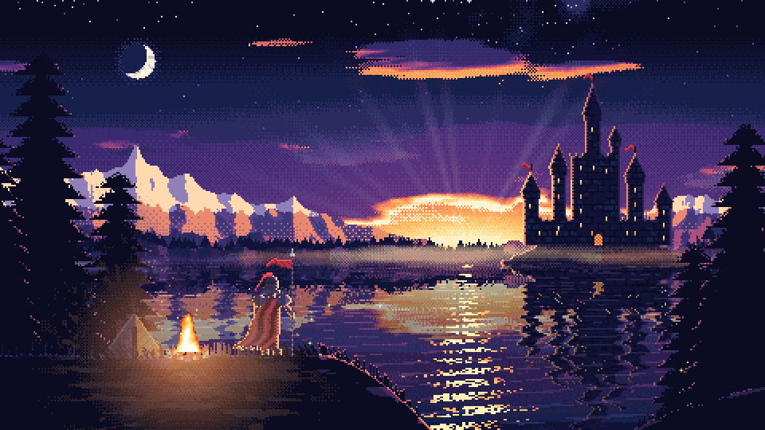</p>

<p align="center"><sub>Painted and animated by Claude in a live Aseprite editor, through this server.<br>
480×270, 16 layers, a 24-frame loop: drifting clouds lit from below, sun rays, mist, a lake that reflects the moving sky and castle, and a campfire that lights the cliff.<br>
No image was imported. Claude checked each pass with <code>look</code> and <code>check_loop</code>, then wrote the GIF with <code>export_animation</code>.</sub></p>

[](https://pypi.org/project/aseprite-claude-connector/)
[](https://github.com/UmarMuhammad18/aseprite-claude-connector/actions/workflows/ci.yml)


## Install

You need Python 3.10+ and Aseprite 1.3+. One command installs the package, registers
the server with Claude Code, and adds the Aseprite extension:

```bash
pip install aseprite-claude-connector && aseprite-claude-connector setup
```

Restart Aseprite, allow the connection once, and ask Claude:

> *"Make a 32×32 potion sprite, animate it bubbling, and show me the loop."*

Using the Claude desktop app or another client? See
[other ways to install](#other-ways-to-install).

## Why this one

- **It works in your open editor.** Edits appear on your canvas as you watch, and each
  one is a named undo step, so Ctrl-Z takes back exactly one thing Claude did. It also
  runs headless against files on disk.
- **Claude sees the canvas.** `look`, `look_animation`, and drawing previews return
  pictures, so Claude checks its work instead of trusting a tool result.
- **Art goes straight into your game.** One action exports to a Godot or Unity project,
  with animations from tags, slices, and pivots already set up.
- **193 typed tools.** Drawing, palettes, animation, tilemaps and autotiles, isometric
  shapes, skies, water and light, cleanup, and art QA.
- **Safe by default.** A pixel cap, dry runs, one-undo batches, a Pause toggle in
  Aseprite, and sockets that only listen on your own computer.

Built on [aseprite-live-mcp](https://github.com/oaktreegames/aseprite-live-mcp) by Kyle
Ocheltree / OakTree Games, MIT licensed.

<details>
<summary><b>Everything this fork adds to aseprite-live-mcp</b></summary>

- **Claude's eyes.** `look`, `look_animation`, and drawing previews return pictures, so
  Claude checks the canvas instead of trusting a tool result.
- **Simple setup.** One command registers the server and installs the extension.
- **Export to Game.** A button in Aseprite, and `export_to_game`, that write into your
  project's sprites folder.
- **Safer edits.** `set_safety_rails`, dry runs, `edit_batch`, and `edit_in_selection`.
- **Animation and cleanup.** `inbetween`, `walk_cycle_template`, `apply_timing`,
  `check_loop`, `find_stray_pixels`, and `recolor_variants`.
- **Art from a reference.** `pixelate_reference` turns a photo or painting into a
  pixel-art layer at your size and palette, and `compare_to_reference` shows where the
  canvas still differs from it, with scores.
- **Living scenes.** `ambient_motion` loops a still scene with wind, water shimmer, a
  light glint, and motes, snow, rain, or embers. `split_into_layers` separates a
  picture into parts from a few points, `extend_scene` widens it with its own
  texture, and `clean_pixel_art` makes a pixelated picture read as drawn.
- **Game assets.** `animate_parts` animates a character from its part layers like a
  cut-out puppet, with crisp RotSprite-style turning. `make_seamless` and
  `make_autotiles` build a 47-tile terrain set with a Godot TileSet or a Unity Rule
  Tile. `make_normal_map` readies art for 2D lights, `relight_scene` makes dawn,
  sunset, and night versions, `clean_lines` tidies sketched strokes, and
  `export_animation` writes a GIF or animated PNG at any whole-number scale.
- **Skies, water, and light.** `paint_sky` lays a dawn, day, sunset, or night sky with a
  sun, stars, and clouds that drift as a loop. `paint_mountains` stands hazy ranges on
  the horizon, `reflect_in_water` mirrors the scene into a rippling lake, `add_fire`
  lights a looping fire with embers, `add_glow` lights the scene from it, and
  `add_rim_light` picks out the edge of a layer that faces the light.
- **Working together.** `add_reference_image`, `change_summary`, `explain_changes`, and
  session recording to a GIF.
- **More export targets.** `export_gamemaker` strips and `pack_atlas` for several sprites
  on one texture.

</details>

## See it in action

Each of these is an AI agent driving a **live** Aseprite canvas through the MCP — one named undo per step.

<table>
<tr>
<td align="center">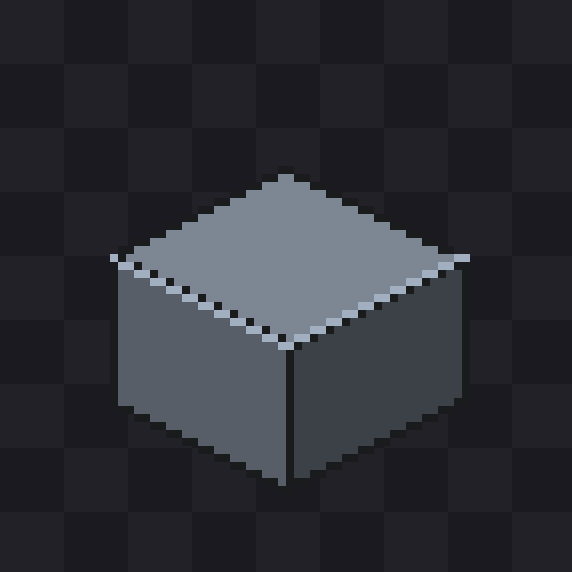<br><sub><b>Isometric primitives</b><br>iso box → recessed port → tank → outline</sub></td>
<td align="center">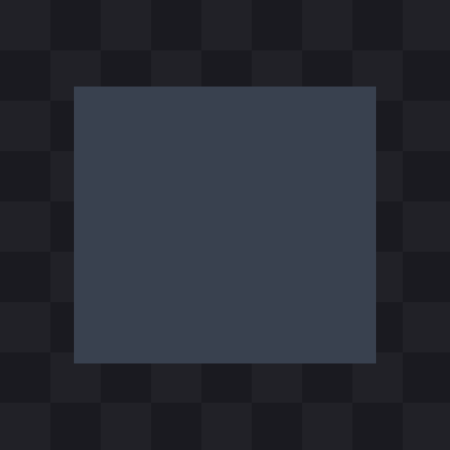<br><sub><b>Drawing suite</b><br>rect · dithered gradient · ellipse · circle · dither · outline</sub></td>
<td align="center">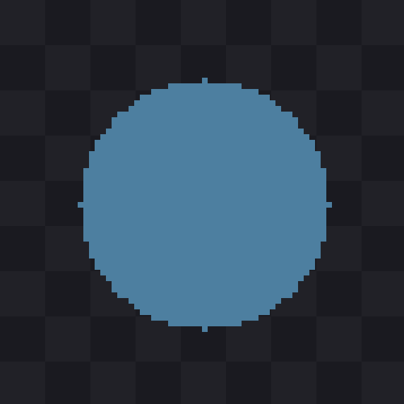<br><sub><b>Ramp-walk shading</b><br>flat fill → volumetric, along a hand-ordered palette</sub></td>
</tr>
<tr>
<td align="center"><br><sub><b>Tilemaps</b><br>tileset drawn tile by tile → map laid out row by row</sub></td>
<td align="center">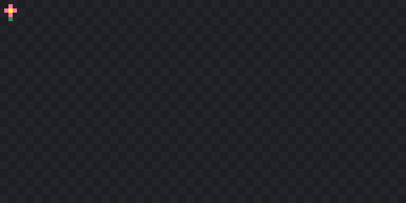<br><sub><b>Stamp painting</b><br>one flower drawn once → scattered along an arc, one undo</sub></td>
<td align="center">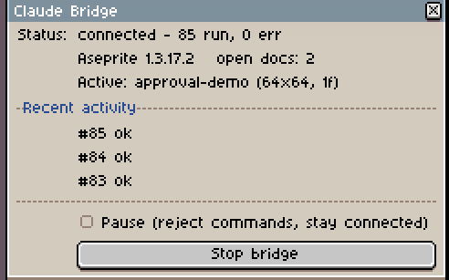<br><sub><b>The bridge panel</b><br>live status, activity log, a Pause toggle — in Aseprite</sub></td>
</tr>
</table>

And the part no headless server can do — the agent asking **you**, inside your editor
(a real screen capture, not a mockup):

<p align="center">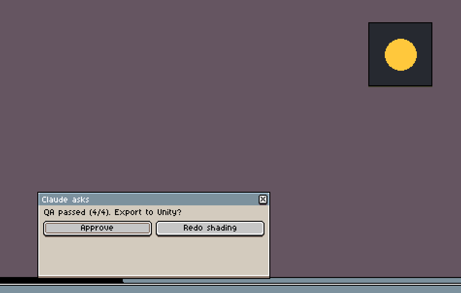</p>

## A full set, one live session

Everything below came out of a single session against one running editor: five
sprites built, QA'd, assembled into a sheet, sliced, and exported for Unity —
finished with an in-editor approval dialog. The `.aseprite` sources are in
[`examples/showcase/`](examples/showcase/); open them and Ctrl-Z backwards
through the build.

<p align="center">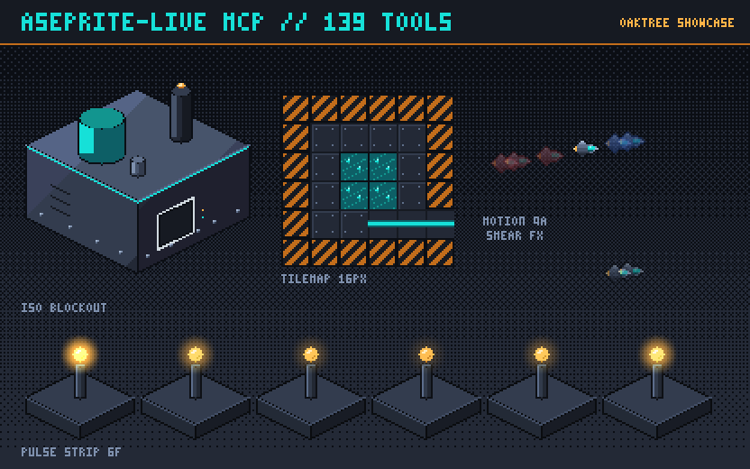</p>

<table>
<tr>
<td align="center">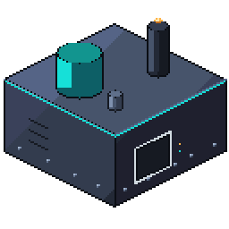<br><sub><b>Iso blockout, QA'd</b><br>face polygons → recessed port · ramp + palette-locked shading · rivets stamped in one undo · <code>qa_sweep</code> 4/4</sub></td>
<td align="center"><br><sub><b>Beacon pulse</b><br>additive glow · eased <code>tween_cel_opacity</code> loop · tagged + timed</sub></td>
<td align="center">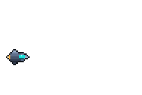<br><sub><b>Drone dash</b><br><code>tween_frames</code> smoothstep · <code>smear_frame</code> streak · endpoints verified with <code>frame_diff</code></sub></td>
</tr>
</table>

The QA tools aren't decoration. During this build, `frame_diff`'s change bbox
caught a motion tween the eye missed — every cel displaced by its image origin
and clipping at the canvas edge. One transaction fixed it; the same diff
re-verified it:

<p align="center">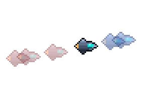<br><sub><code>render_onion_composite</code> — earlier frames red, later frames blue, the whole arc in one image</sub></p>

The sheet's ten slices went to Unity in one action —
[`examples/showcase/unity/`](examples/showcase/unity/) has the atlas PNG and its
generated `.meta`: ten Multiple-mode sprites, rects y-flipped, every pivot baked.

## Other ways to install

<details>
<summary><b>The Claude desktop app (a normal Claude chat)</b></summary>

Add `--desktop` and setup registers the server with the Claude desktop app too:

```bash
pip install aseprite-claude-connector && aseprite-claude-connector setup --desktop
```

Then quit Claude fully (from the tray or menu bar too) and reopen it. The server runs
on your computer, so this works in the desktop app on Windows and Mac, not in
claude.ai in a browser or the phone app.

</details>

<details>
<summary><b>Any other JSON-config client</b></summary>

Install with the command above, using `setup --no-register`, then add:

```jsonc
{
  "mcpServers": {
    "aseprite": {
      "command": "python",
      "args": ["-m", "aseprite_claude_connector"],
      "env": {
        "ASEPRITE_MCP_BACKEND": "headless",           // or "live" — see below
        "ASEPRITE_PATH": "C:/Program Files/Aseprite/Aseprite.exe"
      }
    }
  }
}
```

`ASEPRITE_PATH` is auto-detected on common installs (Steam and standalone) if you
omit it.

</details>

<details>
<summary><b>From source</b></summary>

```bash
git clone https://github.com/UmarMuhammad18/aseprite-claude-connector
cd aseprite-claude-connector
pip install -e .
```

</details>

## Quickstart — headless (2 minutes, no editor open)

Add the server with `"ASEPRITE_MCP_BACKEND": "headless"` (above). In headless
mode, tools take a `file` argument — the `.aseprite` to act on. Ask your agent to
run `status` to confirm the connection, then try:

> *"Create a 32×32 sprite at C:/art/coin.aseprite, draw a gold circle, and export it as coin.png."*

## Quickstart — live editor (drive your open canvas)

The live backend edits your **running** Aseprite, one undo step per edit. Set it up
with one command:

```bash
pip install aseprite-claude-connector && aseprite-claude-connector setup
```

`setup` registers the server with Claude Code and installs the Claude Bridge
extension. Restart Aseprite if it's open, using Cmd+Q on a Mac. It asks once for
permission to connect: tick the box to remember, then allow it. Reload your editor if
Claude Code is running inside one, so it picks up the tools. That's the whole setup.

From then on the server starts the relay itself and Aseprite connects on its own.
Tools act on your active document; watch edits appear and press Ctrl-Z to undo each
one. The sprite Claude creates or opens stays its target even if you click another
tab, so its edits never land in the wrong sprite; say "work on this one" to point it
at the one you have open. **File → Scripts → Claude Bridge** opens a status panel with live activity and
a Pause toggle.

Using another MCP client? Run `aseprite-claude-connector setup --no-register` and add the
server to that client yourself. To install the extension by hand instead,
`aseprite-claude-connector setup --out <folder>` writes a `.aseprite-extension` file you can
add in **Edit → Preferences → Extensions**.

See [`docs/ARCHITECTURE.md`](docs/ARCHITECTURE.md) for how it works.

## Export to your game

In Aseprite, choose **File → Export → Export to Game...**, pick your game folder once,
and press **Export**. Or ask Claude: *"export this to my game"*. Then select the sprite
in your engine.

| Folder you pick | Where it goes | What you get |
| --- | --- | --- |
| Godot project | Your `sprites` or `assets` folder, or a new `sprites` | PNG, plus a `.tres` with animations from tags if it has more than one frame |
| Unity project | `Assets/Sprites` or `Assets/Art` | PNG and a `.meta`, already sliced. Exporting again keeps your prefab references |
| Any other folder | Your `sprites` or `assets` folder, or a new `sprites` | PNG sprite sheet |

For GameMaker, ask for `export_gamemaker`, which writes strips it cuts up on import. To
put several sprites on one texture with JSON frame data, ask for `pack_atlas`.

Pick a folder deeper inside a project to put the art exactly there. The first export
from the button may ask to allow file access: allow it. To export with one key, assign
a shortcut under **Edit → Keyboard Shortcuts**. In Godot, set the node's Texture Filter
to Nearest for sharp pixels.

## What you can ask it to do

- *"Make a 32×32 sprite, draw a red circle, and export it as icon.png."*
- *"Export machines.aseprite as a Unity sprite sheet at 16 pixels-per-unit."* → drops a sheet + a pre-sliced `.meta` straight into your Unity project.
- *"Slice this atlas, set each slice's pivot, and export it to Unity with the pivots baked in."*
- *"Run a QA sweep: it must be 64×64, ≤ 16 colors, grid-aligned, with 2px of sticker padding."*
- *"Draw an isometric box for a 1×1 machine base and put a recessed port on its front face."*
- *"Set up a 16×16 tilemap layer, draw grass and dirt tiles, and lay out a 10×6 ground strip."*
- *"Assemble my exports into one labeled sheet, slice each piece, set the pivots, and hand Unity the atlas."*
- *"Pop a dialog in my editor: approve or redo. Then wait for me to click the anchor point."*
- *"Watch the sprite while I touch it up; when I stop, re-run the QA sweep."*
- *"Diff frames 3 and 4 — did the arm actually move?"*
- *"Look at the walk cycle and tell me which frame pops."*
- *"Draw the outline with a preview, and check it before you carry on."*
- *"Fill in three frames between these two poses, then check that the walk loops cleanly."*
- *"I've selected his arm. Fix the shading, and don't touch anything else."*
- *"Put this sketch on a reference layer and draw over it."*
- *"Recreate this photo as 128-pixel-wide pixel art with 24 colours, then fix wherever it still differs."*
- *"Make this a 384×128 banner, then animate it: wind in the grass, a glint on the armour, and fireflies."*
- *"Split the knight from the meadow so I can recolour his armour."*
- *"Swing his arm from the shoulder over 8 frames, with the forearm following."*
- *"Make this grass tileable, then build an autotile set over dirt for my Godot project."*
- *"Give me a night version with a lantern by the door, and a normal map for 2D lights."*
- *"Paint a sunset sky with drifting clouds and snowy mountains, then turn the bottom third into a lake."*
- *"Light a campfire on the shore with the embers blowing left."*
- *"Light the camp from the fire, and give the knight a rim of sunset light."*
- *"Export the banner as a GIF at 4x."*
- *"Find stray pixels, then make red, blue, and winter versions of this sprite."*
- *"What did you change, and how would I do that by hand in Aseprite?"*
- *"Export this to my game."*

## Where this sits (honest positioning)

There are already good Aseprite MCP servers. This project is **not the first**,
and doesn't claim to be. What it claims — and can defend:

| Capability | Landscape | This project |
|---|---|---|
| Draw / layers / frames / palette / selection / export, dithering, gradients, outlines, filters, tweens, tilemaps | Well covered by the headless leaders (diivi ~123 tools, pixel-mcp, ext-sakamoro) and the commercial live server (Aseprite MCP Pro, Godot-first) | **Parity** — a curated, fully typed surface |
| **One-action Unity export** — sheet + `.meta` with per-slice pivots baked in | Every other Aseprite→Unity path we found is a separate engine-side importer; none export pivots | **Differentiator** ✅ |
| **Art-QA sweep** incl. transparent sticker-padding measurement against your project conventions | We found no other server that lints sprite margins/padding as a packaged sweep | **Differentiator** ✅ |
| **Isometric drawing primitives** (2:1 boxes/cylinders, auto face-shading, recessed panels) | The only iso primitives we've found in any Aseprite MCP we surveyed | **Differentiator** ✅ |
| **In-editor interaction**: dialogs in Aseprite, ask-the-artist point picking, artist-edit watching, symmetry & viewport control | Live-GUI servers exist (Pro commercial; two nascent OSS); none we surveyed ship in-editor dialogs or human-in-the-loop tools | **Differentiator** ✅ |
| **Update awareness** — the server itself tells you when a newer release exists | As far as we could find (checked 2026-07-16), no other MCP server surfaces its own update status through the session | **Differentiator** ✅ |
| **Live tilemap editing** | The headless leaders edit tilemaps on disk; the only live tilemap editing we found is closed-source | Open-source position ✅ |
| MCP resources + prompts | Across the open-source Aseprite MCPs we surveyed, this is the richest MCP-native surface (live-state resources + guided-workflow prompts) | Differentiator (hedged) |

Every edit made **through the server** is exactly one *named* undo step
(`app.transaction`) — you can watch an agent work and Ctrl-Z anything it did,
one step at a time. We verified the other open-source live bridges don't hold
that discipline across their surface (one wraps 3 of 57 tools).

## Knowing when to update

The `status` tool reports the server's version and — at most once a day, via
PyPI — whether a newer release exists. Your agent sees it, so *you* see it:

```json
{ "backend": "live", "connected": true,
  "server": { "current": "0.2.0", "latest": "0.2.1", "update_available": true,
              "how": "pip install -U aseprite-claude-connector" } }
```

Also surfaced as the `aseprite://update` resource, one stderr log line, and the
real version in the MCP `serverInfo` handshake. Disable with
`ASEPRITE_MCP_NO_UPDATE_CHECK=1` (auto-disabled in CI). No telemetry — the check
is an HTTP GET of PyPI's public JSON; nothing about you, your machine, or your
art is sent.

<!-- TOOLS:START -->
## Tools (193)

Every tool is typed, annotated (`readOnlyHint`/`destructiveHint`/`idempotentHint`/`openWorldHint`), and — when it mutates — wrapped in a **named** `app.transaction`, so each edit is exactly one labeled undo step in the editor.

<details>
<summary><b>Inspect & metadata</b> (7)</summary>

- **`status`** — Report backend health plus this server's version and whether a newer release exists.
- **`get_sprite_info`** — Get the active sprite's size, color mode, and layer/frame/tag lists.
- **`describe_sprite`** — Summarize the active sprite in one call: size, color mode, the layer tree with visibility and blend modes, frame timing, tags, slices, palette, the selection, and what's active.
- **`get_pixel`** — Read one composited pixel (all layers) at (x, y) as #rrggbbaa.
- **`set_sprite_metadata`** — Attach typed key/value metadata to the sprite (Aseprite's Properties system — stored in the .aseprite file itself).
- **`get_sprite_metadata`** — Read the sprite's typed key/value metadata (Properties).
- **`get_pixels`** — Read a composited pixel region as a grid of #rrggbbaa strings — the AI feedback loop for 'what does the canvas look like now'.

</details>
<details>
<summary><b>Canvas vision</b> (3)</summary>

- **`look`** — See the canvas: returns a frame as an image, scaled up with sharp pixels.
- **`look_animation`** — See an animation: returns a tag or frame range as one image, frames left to right and top to bottom.
- **`look_onion`** — See motion: returns ``frame`` as an image with earlier frames ghosted in red and later frames in blue, so the whole arc shows at once.

</details>
<details>
<summary><b>Documents & session</b> (7)</summary>

- **`open_sprite`** — Open a sprite file and make it the active document; returns its filename, size, and frame/layer counts.
- **`save_sprite`** — Save the active sprite to disk: to ``path`` if given (save-as; the document's filename follows it), else to its own filename — errors if the sprite is untitled and no ``path`` is given.
- **`close_sprite`** — Close the active sprite.
- **`set_active_sprite`** — Live editor only: make one of the open documents active, found by exact filename or basename match (e.g. "turret.aseprite").
- **`pin_sprite`** — Live editor only: choose the sprite Claude's edits go to.
- **`save_all_sprites`** — Live editor only: save open work into ``folder`` as ``.aseprite`` files, so nothing is lost when tabs are closed.
- **`list_sprites`** — Live editor only: list every open document — filename (or "(unsaved)"), size, frame/layer counts, tags, unsaved-changes flag, which one is active in the editor, and which one Claude's edits go to (``pinned``).

</details>
<details>
<summary><b>Canvas</b> (3)</summary>

- **`create_sprite`** — Create a new sprite.
- **`expand_canvas`** — Grow (or shrink, with negatives) the canvas per side WITHOUT scaling content — existing pixels keep their positions relative to the old origin.
- **`import_spritesheet`** — Slice a sheet PNG into animation frames: cells are read row-major at the given frame size onto a new "imported" layer, adding frames as needed.

</details>
<details>
<summary><b>Layers & groups</b> (14)</summary>

- **`add_layer`** — Add a new empty layer (optionally named) at the top of the stack.
- **`add_group`** — Add a layer group.
- **`move_layer_to_group`** — Move a layer inside a layer group.
- **`list_layers`** — The full layer tree, top of stack first: name, path, kind (image/group/tilemap), visibility, and opacity — including layers nested in groups (which ``get_sprite_info`` lists only at the top level).
- **`delete_layer`** — Delete the layer with the given name.
- **`rename_layer`** — Rename a layer.
- **`set_layer_visibility`** — Show or hide a layer.
- **`set_layer_opacity`** — Set a layer's opacity (0-255).
- **`flatten_sprite`** — Flatten all layers into a single layer.
- **`set_layer_blend_mode`** — Set a layer's blend mode.
- **`duplicate_layer`** — Duplicate a layer (with its cels) above the original.
- **`merge_layer_down`** — Merge a layer into the layer directly beneath it.
- **`move_layer`** — Reorder a layer in the stack.
- **`import_image_as_layer`** — Import an external image file (PNG, etc.) into a new layer at (x, y) — a reference/trace layer for concept-art intake.

</details>
<details>
<summary><b>Frames</b> (8)</summary>

- **`add_frame`** — Append a new empty frame.
- **`duplicate_frame`** — Duplicate frame ``number`` (1-based).
- **`delete_frame`** — Delete frame ``number`` (1-based).
- **`set_frame_duration`** — Set frame ``number``'s duration in milliseconds.
- **`add_frames`** — Append ``count`` empty frames in one undo step.
- **`set_frame_durations`** — Set every frame in [from_frame..to_frame] to ``ms`` milliseconds.
- **`reverse_frames`** — Reverse frame order (cels on every layer, plus durations) — the whole sprite by default, or the inclusive [from_frame..to_frame] range.
- **`set_onion_skin`** — Configure the editor's onion-skin view: on/off, ghost counts each direction, and whether ghosting stays inside the current tag.

</details>
<details>
<summary><b>Cels</b> (3)</summary>

- **`clear_cel`** — Empty the cel at the given layer + frame (transparent).
- **`set_cel_position`** — Move the cel's top-left origin to (x, y).
- **`set_cel_opacity`** — Set the cel's opacity (0-255).

</details>
<details>
<summary><b>Drawing</b> (10)</summary>

- **`draw_pixels`** — Set individual pixels: ``pixels`` is a list of ``{"x": int, "y": int, "color": "#rrggbb[aa]"}``.
- **`draw_polyline`** — Stroke connected line segments through ``points`` (ordered [x, y] pairs); ``close=True`` joins the last point back to the first.
- **`draw_rectangle`** — Draw a rectangle on the active layer + frame.
- **`draw_line`** — Draw a 1px line from (x1,y1) to (x2,y2).
- **`draw_circle`** — Draw a circle centered at (center_x, center_y).
- **`fill_area`** — Flood-fill the contiguous same-color region at (x, y).
- **`draw_ellipse`** — Draw an ellipse centered at (center_x, center_y) with independent x/y radii.
- **`draw_gradient`** — Fill a rectangle with a linear gradient from ``color1`` to ``color2``.
- **`apply_dither`** — Fill a rectangle with a uniform ordered (Bayer 4x4) dither mixing ``color1`` and ``color2``.
- **`add_outline`** — Add a 1px outline around the opaque pixels of a layer, in ``color`` — readability against busy backgrounds.

</details>
<details>
<summary><b>Palette</b> (12)</summary>

- **`get_palette`** — Return the active sprite's palette as #rrggbbaa hex strings.
- **`set_palette_color`** — Set palette entry ``index`` to ``color`` (#rrggbb or #rrggbbaa).
- **`add_palette_color`** — Append ``color`` to the palette and return its new index.
- **`set_palette`** — Replace the whole palette with ``colors`` (list of #rrggbb/#rrggbbaa).
- **`apply_preset_palette`** — Replace the palette with a built-in preset: gameboy | pico8 | cga.
- **`generate_color_ramp`** — Generate a dark->light shading ramp from ``base_color`` and APPEND it to the palette in order — ready for ``palette_ramp_walk``.
- **`extract_palette_from_image`** — Extract a palette (median-cut) from an external image file and, by default, set it as the active sprite's palette — the concept-art → locked-palette step.
- **`sort_palette`** — Reorder palette swatches by ``luminance`` (default), ``hue``, or ``saturation``.
- **`palette_from_sprite`** — Derive the palette FROM the sprite's actual pixels (Aseprite's color quantization) — the inverse of ``quantize_to_palette``.
- **`load_palette`** — Replace the sprite's palette from a palette file (.gpl, .pal, .ase, .png strip — anything Aseprite reads).
- **`save_palette`** — Write the sprite's palette to a file (.gpl, .pal, .png — by extension).
- **`apply_bundled_palette`** — Apply one of Aseprite's bundled extension palettes by resource ID — e.g. DB16, DB32, ARQ4, EDG16 (availability depends on the installed palette extensions).

</details>
<details>
<summary><b>Color</b> (4)</summary>

- **`replace_color`** — Replace every pixel matching ``from_color`` (within ``tolerance``, a 0-255 RGB distance) with ``to_color`` across the active cel, preserving each pixel's alpha unless ``to_color`` carries its own.
- **`quantize_to_palette`** — Snap every opaque pixel of the active cel to its nearest color in the sprite's palette (alpha preserved) — enforce palette discipline after intake or shading.
- **`adjust_hsl`** — Shift the active cel's colors in HSL: ``hue_shift`` degrees (-360..360), ``saturation`` a multiplier (1.0 = unchanged), ``lightness`` a delta (-1..1).
- **`get_color_stats`** — Return a color histogram of the composited sprite: distinct opaque color count, total opaque pixels, and the ``top`` most-used colors with counts — a palette-drift check for the art-QA loop.

</details>
<details>
<summary><b>Shading</b> (2)</summary>

- **`apply_shading`** — Palette-constrained shading: brighten toward the light and darken away from it, snapping every pixel to the nearest palette color.
- **`palette_ramp_walk`** — Shade by WALKING the arranged palette ±N indices toward lighter/darker (per light direction), instead of snapping to the luminance-nearest color — so hand-ordered shading ramps are respected.

</details>
<details>
<summary><b>Filters</b> (5)</summary>

- **`adjust_brightness_contrast`** — Adjust the active cel's brightness and contrast, each -100..100 (0 = unchanged).
- **`invert_colors`** — Invert the active cel's RGB (alpha untouched).
- **`desaturate`** — Convert the active cel to grayscale (Rec. 601 luma), keeping alpha.
- **`box_blur`** — Blur the active cel with an alpha-weighted box kernel.
- **`sharpen`** — Sharpen the active cel (unsharp mask over a 3x3 neighborhood).

</details>
<details>
<summary><b>Stamp painting</b> (1)</summary>

- **`paint_with_stamp`** — Stamp an image at each [x, y] in ``points`` (points are stamp centers).

</details>
<details>
<summary><b>Isometric</b> (4)</summary>

- **`draw_iso_box`** — Draw a 2:1 isometric box.
- **`draw_iso_cylinder`** — Draw a vertical isometric cylinder (tank/silo/chimney): top ellipse + shaded body + front rim, auto-shaded from ``color``.
- **`fill_polygon`** — Scanline-fill an arbitrary polygon given ``points`` (a list of [x, y] pairs, in order).
- **`iso_recessed_panel`** — Draw a recessed docking socket/port on an isometric face — a light lit lip framing a dark recessed interior.

</details>
<details>
<summary><b>Selection</b> (8)</summary>

- **`select_rectangle`** — Set a rectangular selection.
- **`select_all`** — Select the whole canvas.
- **`deselect`** — Clear the current selection.
- **`select_ellipse`** — Select an ellipse inscribed in the given rectangle.
- **`select_by_color`** — Select every pixel matching ``color`` (composited, within ``tolerance`` 0-255 per channel) — a global magic wand.
- **`invert_selection`** — Invert the current selection against the canvas bounds.
- **`get_selection`** — Report whether a selection exists and its bounding rectangle.
- **`erase_area`** — Erase pixels to transparent.

</details>
<details>
<summary><b>Transform</b> (6)</summary>

- **`flip_sprite`** — Flip the whole sprite horizontally or vertically.
- **`resize_sprite`** — Scale the whole sprite to new pixel dimensions.
- **`crop_sprite`** — Crop the sprite to the given rectangle.
- **`rotate_sprite`** — Rotate the whole sprite by 90, 180, or 270 degrees clockwise (lossless).
- **`autocrop_sprite`** — Trim transparent borders: shrink the canvas to the union of visible content across all layers and frames (Sprite > Trim).
- **`set_color_mode`** — Convert the sprite between rgb | gray | indexed color modes.

</details>
<details>
<summary><b>Slices</b> (5)</summary>

- **`create_slice`** — Create a named slice (atlas region) at the given rectangle.
- **`set_slice_pivot`** — Set a slice's pivot point, in pixels relative to the slice's top-left.
- **`set_slice_center`** — Set a slice's 9-patch stretchable center rectangle (relative to the slice).
- **`list_slices`** — List every slice with its bounds, pivot, and 9-patch center.
- **`delete_slice`** — Delete the slice with the given name.

</details>
<details>
<summary><b>Tags</b> (7)</summary>

- **`create_tag`** — Create an animation tag named ``name`` spanning frames ``from_frame``..``to_frame`` (1-based).
- **`delete_tag`** — Delete the animation tag named ``name``.
- **`list_tags`** — List animation tags with their frame ranges.
- **`rename_tag`** — Rename the animation tag ``old_name`` to ``new_name``.
- **`set_tag_color`** — Set the timeline label color of the tag ``name`` (#rrggbb or #rrggbbaa).
- **`set_tag_range`** — Move the tag ``name`` to span frames ``from_frame``..``to_frame`` (1-based, inclusive; validated against the sprite's frame count).
- **`set_tag_direction`** — Set the playback direction of the tag ``name``: forward | reverse | pingpong | pingpong_reverse.

</details>
<details>
<summary><b>Tilemaps</b> (6)</summary>

- **`create_tilemap_layer`** — Create a tilemap layer with its own tileset on a tile_width x tile_height grid.
- **`add_tile`** — Append an empty tile to a tilemap layer's tileset; returns the new tile's index and the tileset size.
- **`draw_on_tile`** — Set pixels on one tile of a tilemap layer's tileset.
- **`set_tiles`** — Place tile references on a tilemap layer's cel.
- **`get_tilemap_info`** — Read a tilemap layer: tile size, tileset length, and the cel's grid size, pixel position, and tile-index grid (``tiles`` as rows of columns, flip flags stripped; capped at 64x64 with ``truncated`` set).
- **`export_tileset`** — Export a tilemap layer's tileset as a horizontal PNG strip (plus an Aseprite JSON atlas if ``data_path`` is given).

</details>
<details>
<summary><b>Animation</b> (5)</summary>

- **`tween_frames`** — Insert ``count`` in-between frames between ``from_frame`` and ``to_frame`` that slide the start frame's art toward where the end frame's art sits, so it works for moved cels and for art redrawn in a new place.
- **`tween_cel_opacity`** — Fade a layer's cels across [from_frame..to_frame]: opacity interpolates from ``from_opacity`` to ``to_opacity`` (0-255) with the chosen easing.
- **`smear_frame`** — Append a motion-smear frame blending ``from_frame`` and ``to_frame``: overlapping pixels averaged, single-frame areas ghosted at half alpha — a pixel-content smear.
- **`frame_diff`** — Pixel-exact diff of two composited frames: changed-pixel count and ratio, the bounding box of the change, and whether they're identical.
- **`render_onion_composite`** — Write a PNG of ``frame`` with up to ``prev`` earlier frames ghosted in red and ``next`` later frames ghosted in blue (Aseprite's onion-skin convention) at the given ghost ``opacity`` — so you can *see* the motion arc in one image.

</details>
<details>
<summary><b>Export</b> (4)</summary>

- **`export_sprite`** — Export the active sprite to a file; format is chosen by ``out_path`` extension (.png, .gif, ...).
- **`export_spritesheet`** — Pack all frames into a single sprite-sheet image (optionally writing a JSON atlas to ``data_path``).
- **`export_layers`** — Export every image layer (recursing into groups) as its own PNG in ``out_dir``, named ``<sanitized-layer-name>.png``.
- **`export_tags`** — Export each animation tag's frame range as its own file in ``out_dir``: an animated ``<tag-name>.gif`` (format="gif", default) or a horizontal ``<tag-name>.png`` strip (format="png").

</details>
<details>
<summary><b>Unity export</b> (2)</summary>

- **`export_unity_sprite`** — Export a horizontal sprite sheet AND write the Unity ``.meta`` beside it, pre-sliced into named Multiple-mode sprites (one per frame) — one action, no manual Sprite Editor pass.
- **`export_unity_slices`** — Export the sprite as a single PNG AND write a Unity ``.meta`` with one Multiple-mode sprite **per named slice**, each carrying that slice's pivot — so an atlas laid out with slices imports into Unity already sliced *and* pivoted.

</details>
<details>
<summary><b>Art QA</b> (2)</summary>

- **`measure_padding`** — Measure the transparent 'sticker' padding around the content: content bounding box, per-side padding (left/right/top/bottom), fill ratio, and distinct opaque color count.
- **`qa_sweep`** — Audit the active sprite against project conventions and return per-check pass/fail.

</details>
<details>
<summary><b>Batch (whole folder)</b> (3)</summary>

- **`batch_export`** — Export every ``.aseprite`` in ``folder`` (first frame) to an image, optionally integer-upscaled by ``scale``.
- **`batch_resize`** — Resize every ``.aseprite`` in ``folder`` (first frame, nearest-neighbor) and write images to ``out_dir``.
- **`batch_apply_palette`** — Palette-lock every ``.aseprite`` in ``folder``: snap each sprite (first frame, alpha preserved) to a palette and export images to ``out_dir``.

</details>
<details>
<summary><b>Animation helpers</b> (4)</summary>

- **`inbetween`** — Fill in ``count`` frames between the key pose on ``from_frame`` and the one on the next frame, then return a picture of the result.
- **`walk_cycle_template`** — Lay down a timed, tagged walk or run skeleton to draw over.
- **`apply_timing`** — Set frame durations from a preset, over a tag or a frame range (every frame by default).
- **`check_loop`** — Check whether an animation loops cleanly: compares its last frame with its first against the steps inside the loop.

</details>
<details>
<summary><b>Part animation</b> (1)</summary>

- **`animate_parts`** — Animate a character made of part layers like a cut-out puppet.

</details>
<details>
<summary><b>Characters</b> (6)</summary>

- **`draw_eyes`** — Redraw a character's eyes, frame by frame, to give it an expression: where it looks, blinks, sleepy or angry lids, a smile.
- **`swing_part`** — Swing a wing, arm, tail or ear about its joint across frames.
- **`bob_body`** — Breathing, hops and sways: everything above the row ``feet_y`` moves while the feet below it stay planted.
- **`lift_symbols`** — Move floating symbols ("!", "?", Zzz, hearts, sparkles) off a character's layer onto a new layer, and animate them there.
- **`check_consistency`** — Compare sprites of one character or set: the open sprites (live; ``only`` picks them by filename or tag), or ``files``.
- **`match_palettes`** — Put sprites of one character or set on one shared palette: colours closer than ``tolerance`` that stand in for each other (one sprite uses one, another sprite the other) merge into whichever is used most, across the open sprites (live; ``on

</details>
<details>
<summary><b>Art from a reference</b> (3)</summary>

- **`split_sheet`** — Cut a character sheet (poses in a ``columns`` x ``rows`` grid) into one pixel-art sprite per pose, all at the same scale and on ONE shared palette of ``colors`` colours (or ``palette``), so the poses stay consistent with each other.
- **`pixelate_reference`** — Turn a reference picture into pixel art on a new layer: the faithful way to recreate a photo or painting.
- **`compare_to_reference`** — See how close the canvas is to a reference picture.

</details>
<details>
<summary><b>Living scenes</b> (4)</summary>

- **`ambient_motion`** — Bring a still scene to life as a seamless loop.
- **`split_into_layers`** — Separate a picture into parts on their own layers, like armour and meadow, so each can be edited or animated alone.
- **`extend_scene`** — Grow the canvas by ``left``/``right``/``top``/``bottom`` pixels and fill the new space on ``layer`` (the active one) by continuing its own texture, like turning a portrait scene into a wide banner.
- **`clean_pixel_art`** — Make pixelated or noisy art read as drawn: every patch of one colour smaller than ``min_region`` pixels merges into the colour around it, if that colour is close (``tolerance``, 0-1; standout specks like flowers stay), and ``firm_edges`` da

</details>
<details>
<summary><b>Skies, water & light</b> (6)</summary>

- **`paint_sky`** — Paint a sky behind the art: ``dawn``, ``day``, ``sunset``, or ``night``, shaded in dithered bands from the top down to row ``horizon`` (the bottom edge by default).
- **`paint_mountains`** — Paint mountain ranges standing on row ``horizon``: up to three ``ranges``, the far one palest and hazy at its foot, the near one dark.
- **`add_fire`** — Light a fire with the middle of its base at ``x``, ``y``: flames ``height`` pixels tall that lick and sway, and embers that rise above them and lean with ``wind`` (pixels; negative blows left).
- **`reflect_in_water`** — Fill everything below row ``horizon`` with water that mirrors what is above it.
- **`add_glow`** — Light the scene from a fire, lantern, or window at ``x``, ``y``: a pool of ``color`` that fades out by ``radius`` in dithered steps, on a new layer that adds its light to what is under it.
- **`add_rim_light`** — Pick out the edge of ``layer`` that faces a light: a sunset behind a figure, a fire beside a tree.

</details>
<details>
<summary><b>Time of day & normal maps</b> (2)</summary>

- **`relight_scene`** — Show a scene at another time of day: ``dawn``, ``noon``, ``sunset``, or ``night``.
- **`make_normal_map`** — Make a normal map so the art reacts to 2D lights in Godot and Unity: a torch moving past shades it.

</details>
<details>
<summary><b>Seamless tiles & autotiles</b> (2)</summary>

- **`make_seamless`** — Make a texture repeat with no visible edge, for ground, walls, or water tiles.
- **`make_autotiles`** — Build the 47-tile autotile set for one terrain (``fill_layer``, like grass) over another (``base_layer``, like dirt, or clear), so a map painter picks the right edge and corner for every neighbour.

</details>
<details>
<summary><b>Cleanup</b> (2)</summary>

- **`find_stray_pixels`** — Find pixels and colors that look like accidents, and return a picture of them: the art in gray, with floating ``isolated`` pixels in red, ``orphan`` pixels (touching art but matching none of it) in yellow, and pixels of colors used ``rare``
- **`recolor_variants`** — Recolor the sprite into team colors or seasons in one batch.

</details>
<details>
<summary><b>Finishing</b> (2)</summary>

- **`export_animation`** — Write the animation (or one ``tag``) as a looping ``.gif`` or animated ``.png`` at ``path``, scaled up ``scale`` times with sharp pixels (4 turns a 384x128 banner into 1536x512).
- **`clean_lines`** — Turn rough sketched strokes into clean pixel-art lines: ``thin`` brings thick strokes down to one pixel, and the doubled corner pixels freehand lines leave are removed, as Aseprite's pixel-perfect brush would have drawn them.

</details>
<details>
<summary><b>Godot export</b> (1)</summary>

- **`export_godot`** — Export a horizontal sprite sheet AND a Godot 4 ``SpriteFrames`` ``.tres`` beside it, with one animation per tag, keeping each frame's timing, the tag's direction, and its repeat count.

</details>
<details>
<summary><b>Export to Game</b> (1)</summary>

- **`export_to_game`** — Export the sprite into a game project in one action, ready to select in the engine.

</details>
<details>
<summary><b>Atlas packing</b> (2)</summary>

- **`export_gamemaker`** — Write sprite strips GameMaker cuts up by itself: one ``<name>_<tag>_stripN.png`` per tag, or ``<name>_stripN.png`` with no tags.
- **`pack_atlas`** — Pack several sprites into one texture, with every frame of each, plus a JSON map in the hash layout of Aseprite's sprite-sheet export.

</details>
<details>
<summary><b>Safety rails</b> (3)</summary>

- **`set_safety_rails`** — Set the safety rails for this session, or pass nothing to read them.
- **`edit_batch`** — Run several editing tools as one undo step, so one Ctrl-Z reverts them all.
- **`edit_in_selection`** — "Fix this bit": run editing tools so they change only what's inside the current selection, as one undo step.

</details>
<details>
<summary><b>Working together</b> (5)</summary>

- **`add_reference_image`** — Put a sketch or reference on a faded, locked layer on top of the sprite, across every frame, and keep the active layer as it was, so drawing lands on the art.
- **`change_summary`** — A short list of what Claude changed this session, oldest first: each edit, how many times in a row, the frames and layers it touched, and pixels changed.
- **`explain_changes`** — Say which Aseprite tool, menu, or shortcut would do what Claude just did, so you pick up the technique.
- **`start_recording`** — Start recording this session: a picture of the active frame is kept after every edit, for ``stop_recording`` to turn into a GIF timelapse.
- **`stop_recording`** — Stop recording and write the timelapse GIF to ``out_path``.

</details>
<details>
<summary><b>Docs search</b> (2)</summary>

- **`search_api_docs`** — Search Aseprite's Lua scripting API reference, bundled with this server.
- **`search_manual`** — Search Aseprite's user manual: how features work in the editor, such as tilemaps, onion skinning, or slices.

</details>
<details>
<summary><b>Undo / redo</b> (4)</summary>

- **`select_frame`** — Make a frame active, so the next edits land on it.
- **`select_layer`** — Make a layer active, so the next edits land on it.
- **`undo`** — Undo the last edit on the active sprite (live editor).
- **`redo`** — Redo the last undone edit (live editor).

</details>
<details>
<summary><b>Live editor (interactive)</b> (11)</summary>

- **`get_editor_state`** — Live editor only: current zoom, scroll, and which sprite pixel the mouse is over — lets an agent know what the artist is looking at.
- **`set_editor_view`** — Live editor only: set the viewport zoom (1.0 = 100%) and/or scroll — e.g. zoom to the region you're about to edit so the artist can watch.
- **`set_symmetry`** — Live editor only: set mirror-painting symmetry — ``mode`` is ``none``, ``horizontal`` (mirror across a vertical axis), ``vertical``, or ``both``; optionally place the axis lines.
- **`ask_point`** — Live editor only: ask the ARTIST to click a point on the canvas (pivot, anchor, paint origin).
- **`get_asked_point`** — Poll the result of ``ask_point``: ``done`` false while waiting, then the clicked ``x``/``y`` (or ``cancelled`` if the artist pressed Esc).
- **`cancel_ask_point`** — Withdraw a pending ``ask_point`` request (e.g. the artist stepped away and you're moving on).
- **`show_choice_dialog`** — Live editor only: pop a small dialog IN Aseprite with a message and up to 4 option buttons (e.g. approve/redo).
- **`get_dialog_choice`** — Poll the result of ``show_choice_dialog``: ``done`` false while the dialog is open, then the chosen button text.
- **`watch_changes`** — Live editor only: start counting edits the ARTIST makes to the active sprite (via ``Sprite.events``).
- **`get_watched_changes`** — Poll the change counter started by ``watch_changes`` (``reset=True`` zeroes it after reading).
- **`stop_watching_changes`** — Detach the ``watch_changes`` listener.

</details>
<details>
<summary><b>Advanced</b> (1)</summary>

- **`run_lua`** — Run arbitrary Lua inside Aseprite and return its result (advanced escape hatch — equivalent to local code execution).

</details>
<!-- TOOLS:END -->

## Resources

Read editor state without spending a tool call:

- `aseprite://sprite/active` — size, color mode, layer/frame/tag names of the active document
- `aseprite://palette/active` — the active palette as hex
- `aseprite://docs` — every open document, including unsaved/untitled tabs (live)
- `aseprite://qa/last` — the most recent `qa_sweep` / `measure_padding` result
- `aseprite://export/last` — the most recent Unity export (files written + sprite manifest)
- `aseprite://update` — this server's version + whether a newer release exists

## Prompts (guided workflows)

One-call "skills" that chain the tools into finished art tasks:

- `unity_qa_gate` — run the ship-ready QA gate, then export a Unity sheet + `.meta`
- `iso_building_to_spec` — build a 2:1 isometric building from a footprint spec
- `shade_along_ramp` — shade a sprite by walking its hand-ordered palette ramp
- `autoslice_to_unity` — multi-frame sprite → Unity-import-ready sheet + pre-sliced `.meta`
- `concept_to_placeholder` — external concept image → correctly-padded, in-palette placeholder
- `tileset_and_map` — author a tileset from a terrain spec, lay out the map, export the strip
- `live_review_loop` — wait for the artist to finish touching up, re-QA, ask for the ship call in-editor
- `recreate_picture` — turn a photo or painting into pixel art, then refine it until it matches
- `make_banner` — turn a picture into a wide banner, keeping the subject and extending the scene
- `animate_scene` — bring a still scene to life as a seamless loop: wind, glints, water, particles

## Limitations (honest ones)

- **Headless calls are separate Aseprite processes** — editor-session state
  (selection, view, symmetry) doesn't persist between headless calls. Pixels,
  layers, frames, palettes, tilemaps, metadata: all persist (they're in the file).
- **The interactive tools need the live editor** — dialogs, point picking,
  watching, viewport control error cleanly under `headless`.
- **Animated `.gif` export is headless-only.** Saving `.gif` from the live
  editor opens Aseprite's GIF-options dialog, which blocks the bridge until
  dismissed. Live, use `export_spritesheet` strips or per-frame PNGs; the
  animated GIFs in this README were exported headless from the same files.
- **Windows is the primary dev platform.** CI runs the unit + wire-validation
  suite on Linux/macOS/Windows, and the `Mac` workflow compiles Aseprite on a Mac and
  runs setup and every tool against it headless. The live bridge in a running editor
  is hand-tested on Windows only, because its first connection needs a person to answer
  Aseprite's access prompt. Linux is expected to work, not proven.
- **`run_lua` is local code execution** by design (it's the escape hatch). The
  relay binds to `127.0.0.1` only and refuses browsers. Read
  [`SECURITY.md`](SECURITY.md).
- **Some live tools raise an Aseprite security prompt.** `open_sprite`, `save_sprite`,
  `load_palette`, and exports that write from Lua can, and the call times out if nobody
  answers. Importing pictures, `pack_atlas`, and exports built in Python don't.
- **Engine imports aren't all proven.** CI loads a real export in headless Godot, but
  nobody has opened the Unity or GameMaker output in those engines, and the Export to
  Game dialog hasn't been clicked through.
- **No generative art.** This server draws what it's told with deterministic
  primitives; taste stays with the artist.

## Verifying the surface

`python tests/smoke_headless.py` drives every tool (plus resources + prompts)
in-process against a throwaway sprite. `python -m pytest` runs the unit suite
plus **wire-validation** tests that exercise structured output through a real
MCP client session — the boundary users actually hit (`pip install -e ".[dev]"`
first). The README's tool list is generated from the code
(`python scripts/gen_docs.py`) and CI fails if it drifts. The `Mac` workflow compiles
Aseprite and runs setup and every tool against it, then has real Godot load an export
and paint with an autotile set. The `Release check` workflow installs each published
version from PyPI on Windows, Linux, and Mac and checks it runs. The `Unity` workflow
has real Unity import the exports and paint with the Rule Tile, once the repository
has a Unity licence ([`unity/README.md`](unity/README.md)). To test the live
connection on a Mac without buying Aseprite, see
[`docs/MAC_TESTING.md`](docs/MAC_TESTING.md).

## Changelog & releases

See [`CHANGELOG.md`](CHANGELOG.md) — every release also lands as a GitHub Release
with the same notes. Versions follow semver (pre-1.0: minor bumps may change
tool behavior, patches are fixes).

## About

The original project was built solo by [Kyle Ocheltree](https://github.com/oaktreegames) (OakTree Games)
for a real production pipeline — the Unity export, padding QA, and isometric
tools exist because Cosmic Scale (an isometric factory game) needed
them. Developed with an AI-native workflow: AI assists the coding; every tool
is reviewed, tested against a real editor, and shipped deliberately.

## Contributing

Issues and PRs welcome — see [`CONTRIBUTING.md`](CONTRIBUTING.md). Run
`ruff check .`, `pytest`, and `python tests/smoke_headless.py` before submitting.

## License

MIT — see [`LICENSE`](LICENSE). © 2026 Kyle Ocheltree / OakTree Games.

<!-- mcp-name: io.github.UmarMuhammad18/aseprite-claude-connector -->
<!-- The line above is the MCP Registry PyPI ownership marker (ships in the PyPI
     description). It must match the "name" in server.json. Do not remove. -->
