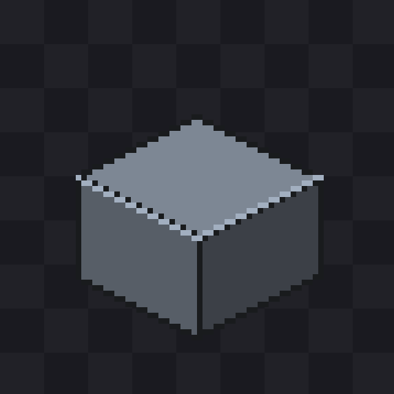
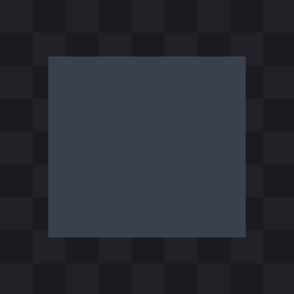
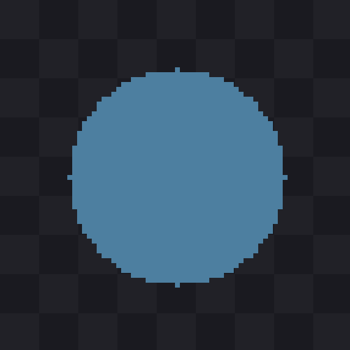
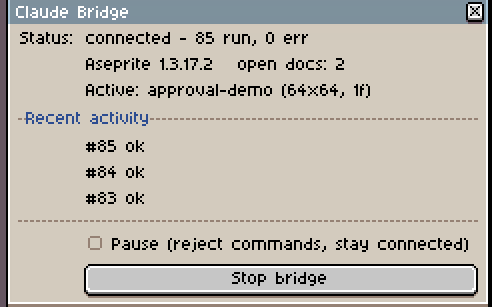
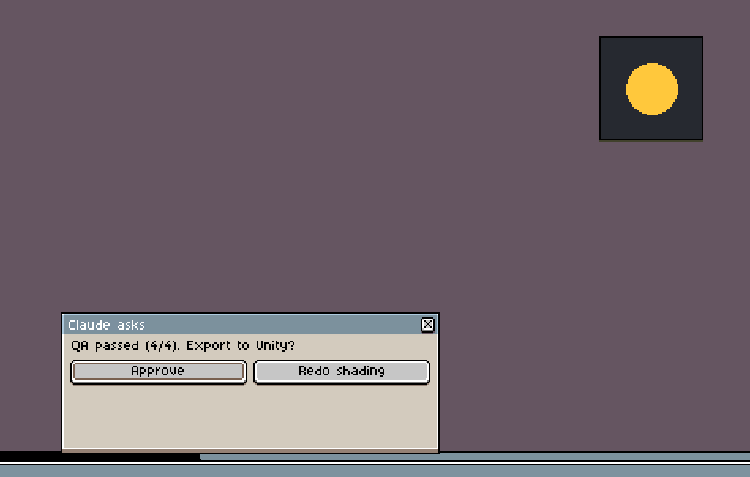
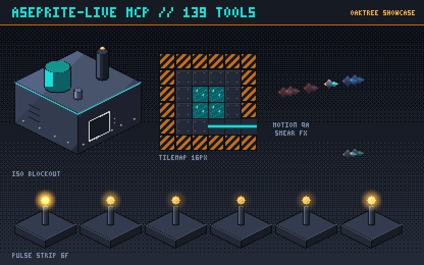
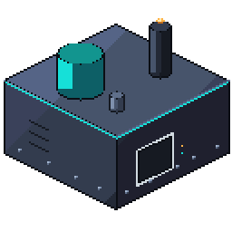
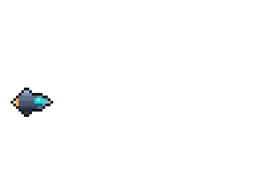
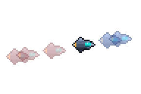

# aseprite-live-mcp

[](https://pypi.org/project/aseprite-live-mcp/)
[](https://pypi.org/project/aseprite-live-mcp/)
[](https://github.com/oaktreegames/aseprite-live-mcp/actions/workflows/ci.yml)


**Let an AI agent draw in your *live* Aseprite editor — every edit one named undo — with a Unity-first, game-dev toolset.**

An open-source [Model Context Protocol](https://modelcontextprotocol.io) server for
[Aseprite](https://www.aseprite.org/). It drives your **running editor** (all open
documents, unsaved tabs, in-editor dialogs, even asking *you* to click a point on
the canvas) *and* runs **headless** (`aseprite --batch`) against files on disk.
One-action **Unity sprite-sheet + `.meta` export** with per-slice pivots, a
project-convention **art-QA sweep**, **isometric primitives**, **tilemaps**, and a
server that **tells you when it's out of date**.

## See it in action

Each of these is an AI agent driving a **live** Aseprite canvas through the MCP — one named undo per step.

<table>
<tr>
<td align="center"><br><sub><b>Isometric primitives</b><br>iso box → recessed port → tank → outline</sub></td>
<td align="center"><br><sub><b>Drawing suite</b><br>rect · dithered gradient · ellipse · circle · dither · outline</sub></td>
<td align="center"><br><sub><b>Ramp-walk shading</b><br>flat fill → volumetric, along a hand-ordered palette</sub></td>
</tr>
<tr>
<td align="center"><br><sub><b>Tilemaps</b><br>tileset drawn tile by tile → map laid out row by row</sub></td>
<td align="center"><br><sub><b>Stamp painting</b><br>one flower drawn once → scattered along an arc, one undo</sub></td>
<td align="center"><br><sub><b>The bridge panel</b><br>live status, activity log, a Pause toggle — in Aseprite</sub></td>
</tr>
</table>

And the part no headless server can do — the agent asking **you**, inside your editor
(a real screen capture, not a mockup):

<p align="center"></p>

## A full set, one live session

Everything below came out of a single session against one running editor: five
sprites built, QA'd, assembled into a sheet, sliced, and exported for Unity —
finished with an in-editor approval dialog. The `.aseprite` sources are in
[`examples/showcase/`](examples/showcase/); open them and Ctrl-Z backwards
through the build.

<p align="center"></p>

<table>
<tr>
<td align="center"><br><sub><b>Iso blockout, QA'd</b><br>face polygons → recessed port · ramp + palette-locked shading · rivets stamped in one undo · <code>qa_sweep</code> 4/4</sub></td>
<td align="center"><br><sub><b>Beacon pulse</b><br>additive glow · eased <code>tween_cel_opacity</code> loop · tagged + timed</sub></td>
<td align="center"><br><sub><b>Drone dash</b><br><code>tween_frames</code> smoothstep · <code>smear_frame</code> streak · endpoints verified with <code>frame_diff</code></sub></td>
</tr>
</table>

The QA tools aren't decoration. During this build, `frame_diff`'s change bbox
caught a motion tween the eye missed — every cel displaced by its image origin
and clipping at the canvas edge. One transaction fixed it; the same diff
re-verified it:

<p align="center"><br><sub><code>render_onion_composite</code> — earlier frames red, later frames blue, the whole arc in one image</sub></p>

The sheet's ten slices went to Unity in one action —
[`examples/showcase/unity/`](examples/showcase/unity/) has the atlas PNG and its
generated `.meta`: ten Multiple-mode sprites, rects y-flipped, every pivot baked.

## Install

One command, no clone:

```bash
uvx aseprite-live-mcp        # or: pipx run aseprite-live-mcp
```

Requires **Python 3.10+** and **Aseprite 1.3+**. That's it for headless; the live
editor needs one extra step (below).

[](https://insiders.vscode.dev/redirect/mcp/install?name=aseprite-live&config=%7B%22type%22%3A%22stdio%22%2C%22command%22%3A%22uvx%22%2C%22args%22%3A%5B%22aseprite-live-mcp%22%5D%7D)
[](https://cursor.com/install-mcp?name=aseprite-live&config=eyJjb21tYW5kIjoidXZ4IGFzZXByaXRlLWxpdmUtbWNwIn0%3D)

<details>
<summary><b>Claude Code</b></summary>

```bash
claude mcp add aseprite-live -- uvx aseprite-live-mcp
```

</details>

<details>
<summary><b>Claude Desktop / any JSON-config client</b></summary>

```jsonc
{
  "mcpServers": {
    "aseprite-live": {
      "command": "uvx",
      "args": ["aseprite-live-mcp"],
      "env": {
        "ASEPRITE_MCP_BACKEND": "headless",           // or "live" — see below
        "ASEPRITE_PATH": "C:/Program Files/Aseprite/Aseprite.exe"
      }
    }
  }
}
```

`ASEPRITE_PATH` is auto-detected on common installs (Steam and standalone) if you
omit it.

</details>

<details>
<summary><b>From source</b></summary>

```bash
git clone https://github.com/oaktreegames/aseprite-live-mcp
cd aseprite-live-mcp
pip install -e .
```

</details>

## Quickstart — headless (2 minutes, no editor open)

Add the server with `"ASEPRITE_MCP_BACKEND": "headless"` (above). In headless
mode, tools take a `file` argument — the `.aseprite` to act on. Ask your agent to
run `status` to confirm the connection, then try:

> *"Create a 32×32 sprite at C:/art/coin.aseprite, draw a gold circle, and export it as coin.png."*

## Quickstart — live editor (drive your open canvas)

The live backend edits your **running** Aseprite, one undo step per edit. Set it up
with one command:

```bash
pip install git+https://github.com/UmarMuhammad18/aseprite-claude-connector && aseprite-live-mcp setup
```

`setup` registers the server with Claude Code and installs the Claude Bridge
extension. Restart Aseprite if it's open. It asks once for permission to connect:
tick the box to remember, then allow it. That's the whole setup.

From then on the server starts the relay itself and Aseprite connects on its own.
Tools act on your active document; watch edits appear and press Ctrl-Z to undo each
one. **File → Scripts → Claude Bridge** opens a status panel with live activity and
a Pause toggle.

Using another MCP client? Run `aseprite-live-mcp setup --no-register` and add the
server to that client yourself. To install the extension by hand instead,
`aseprite-live-mcp setup --out <folder>` writes a `.aseprite-extension` file you can
add in **Edit → Preferences → Extensions**.

See [`docs/ARCHITECTURE.md`](docs/ARCHITECTURE.md) for how it works.

## What you can ask it to do

- *"Make a 32×32 sprite, draw a red circle, and export it as icon.png."*
- *"Export machines.aseprite as a Unity sprite sheet at 16 pixels-per-unit."* → drops a sheet + a pre-sliced `.meta` straight into your Unity project.
- *"Slice this atlas, set each slice's pivot, and export it to Unity with the pivots baked in."*
- *"Run a QA sweep: it must be 64×64, ≤ 16 colors, grid-aligned, with 2px of sticker padding."*
- *"Draw an isometric box for a 1×1 machine base and put a recessed port on its front face."*
- *"Set up a 16×16 tilemap layer, draw grass and dirt tiles, and lay out a 10×6 ground strip."*
- *"Assemble my exports into one labeled sheet, slice each piece, set the pivots, and hand Unity the atlas."*
- *"Pop a dialog in my editor: approve or redo. Then wait for me to click the anchor point."*
- *"Watch the sprite while I touch it up; when I stop, re-run the QA sweep."*
- *"Diff frames 3 and 4 — did the arm actually move?"*
- *"Look at the walk cycle and tell me which frame pops."*
- *"Draw the outline with a preview, and check it before you carry on."*

## Where this sits (honest positioning)

There are already good Aseprite MCP servers. This project is **not the first**,
and doesn't claim to be. What it claims — and can defend:

| Capability | Landscape | This project |
|---|---|---|
| Draw / layers / frames / palette / selection / export, dithering, gradients, outlines, filters, tweens, tilemaps | Well covered by the headless leaders (diivi ~113 tools, pixel-mcp, ext-sakamoro) and the commercial live server (Aseprite MCP Pro, Godot-first) | **Parity** — a curated, fully typed surface |
| **One-action Unity export** — sheet + `.meta` with per-slice pivots baked in | Every other Aseprite→Unity path we found is a separate engine-side importer; none export pivots | **Differentiator** ✅ |
| **Art-QA sweep** incl. transparent sticker-padding measurement against your project conventions | We found no other server that lints sprite margins/padding as a packaged sweep | **Differentiator** ✅ |
| **Isometric drawing primitives** (2:1 boxes/cylinders, auto face-shading, recessed panels) | The only iso primitives we've found in any Aseprite MCP we surveyed | **Differentiator** ✅ |
| **In-editor interaction**: dialogs in Aseprite, ask-the-artist point picking, artist-edit watching, symmetry & viewport control | Live-GUI servers exist (Pro commercial; two nascent OSS); none we surveyed ship in-editor dialogs or human-in-the-loop tools | **Differentiator** ✅ |
| **Update awareness** — the server itself tells you when a newer release exists | As far as we could find (checked 2026-07-16), no other MCP server surfaces its own update status through the session | **Differentiator** ✅ |
| **Live tilemap editing** | The headless leaders edit tilemaps on disk; the only live tilemap editing we found is closed-source | Open-source position ✅ |
| MCP resources + prompts | Across the open-source Aseprite MCPs we surveyed, this is the richest MCP-native surface (live-state resources + guided-workflow prompts) | Differentiator (hedged) |

Every edit made **through the server** is exactly one *named* undo step
(`app.transaction`) — you can watch an agent work and Ctrl-Z anything it did,
one step at a time. We verified the other open-source live bridges don't hold
that discipline across their surface (one wraps 3 of 57 tools).

## Knowing when to update

The `status` tool reports the server's version and — at most once a day, via
PyPI — whether a newer release exists. Your agent sees it, so *you* see it:

```json
{ "backend": "live", "connected": true,
  "server": { "current": "0.2.0", "latest": "0.2.1", "update_available": true,
              "how": "pip install -U aseprite-live-mcp (uvx users: run uvx aseprite-live-mcp@latest once — uvx reuses its cached version otherwise)" } }
```

Also surfaced as the `aseprite://update` resource, one stderr log line, and the
real version in the MCP `serverInfo` handshake. Disable with
`ASEPRITE_MCP_NO_UPDATE_CHECK=1` (auto-disabled in CI). No telemetry — the check
is an HTTP GET of PyPI's public JSON; nothing about you, your machine, or your
art is sent.

<!-- TOOLS:START -->
## Tools (142)

Every tool is typed, annotated (`readOnlyHint`/`destructiveHint`/`idempotentHint`/`openWorldHint`), and — when it mutates — wrapped in a **named** `app.transaction`, so each edit is exactly one labeled undo step in the editor.

<details>
<summary><b>Inspect & metadata</b> (6)</summary>

- **`status`** — Report backend health plus this server's version and whether a newer release exists.
- **`get_sprite_info`** — Get the active sprite's size, color mode, and layer/frame/tag lists.
- **`get_pixel`** — Read one composited pixel (all layers) at (x, y) as #rrggbbaa.
- **`set_sprite_metadata`** — Attach typed key/value metadata to the sprite (Aseprite's Properties system — stored in the .aseprite file itself).
- **`get_sprite_metadata`** — Read the sprite's typed key/value metadata (Properties).
- **`get_pixels`** — Read a composited pixel region as a grid of #rrggbbaa strings — the AI feedback loop for 'what does the canvas look like now'.

</details>
<details>
<summary><b>Canvas vision</b> (3)</summary>

- **`look`** — See the canvas: returns a frame as an image, scaled up with sharp pixels.
- **`look_animation`** — See an animation: returns a tag or frame range as one image, frames left to right and top to bottom.
- **`look_onion`** — See motion: returns ``frame`` as an image with earlier frames ghosted in red and later frames in blue, so the whole arc shows at once.

</details>
<details>
<summary><b>Documents & session</b> (5)</summary>

- **`open_sprite`** — Open a sprite file and make it the active document; returns its filename, size, and frame/layer counts.
- **`save_sprite`** — Save the active sprite to disk: to ``path`` if given (save-as; the document's filename follows it), else to its own filename — errors if the sprite is untitled and no ``path`` is given.
- **`close_sprite`** — Close the active sprite.
- **`set_active_sprite`** — Live editor only: make one of the open documents active, found by exact filename or basename match (e.g. "turret.aseprite").
- **`list_sprites`** — Live editor only: list every open document — filename (or "(unsaved)"), size, frame/layer counts, unsaved-changes flag, and which one is active.

</details>
<details>
<summary><b>Canvas</b> (3)</summary>

- **`create_sprite`** — Create a new sprite.
- **`expand_canvas`** — Grow (or shrink, with negatives) the canvas per side WITHOUT scaling content — existing pixels keep their positions relative to the old origin.
- **`import_spritesheet`** — Slice a sheet PNG into animation frames: cells are read row-major at the given frame size onto a new "imported" layer, adding frames as needed.

</details>
<details>
<summary><b>Layers & groups</b> (14)</summary>

- **`add_layer`** — Add a new empty layer (optionally named) at the top of the stack.
- **`add_group`** — Add a layer group.
- **`move_layer_to_group`** — Move a layer inside a layer group.
- **`list_layers`** — The full layer tree, top of stack first: name, path, kind (image/group/tilemap), visibility, and opacity — including layers nested in groups (which ``get_sprite_info`` lists only at the top level).
- **`delete_layer`** — Delete the layer with the given name.
- **`rename_layer`** — Rename a layer.
- **`set_layer_visibility`** — Show or hide a layer.
- **`set_layer_opacity`** — Set a layer's opacity (0-255).
- **`flatten_sprite`** — Flatten all layers into a single layer.
- **`set_layer_blend_mode`** — Set a layer's blend mode.
- **`duplicate_layer`** — Duplicate a layer (with its cels) above the original.
- **`merge_layer_down`** — Merge a layer into the layer directly beneath it.
- **`move_layer`** — Reorder a layer in the stack.
- **`import_image_as_layer`** — Import an external image file (PNG, etc.) into a new layer at (x, y) — a reference/trace layer for concept-art intake.

</details>
<details>
<summary><b>Frames</b> (8)</summary>

- **`add_frame`** — Append a new empty frame.
- **`duplicate_frame`** — Duplicate frame ``number`` (1-based).
- **`delete_frame`** — Delete frame ``number`` (1-based).
- **`set_frame_duration`** — Set frame ``number``'s duration in milliseconds.
- **`add_frames`** — Append ``count`` empty frames in one undo step.
- **`set_frame_durations`** — Set every frame in [from_frame..to_frame] to ``ms`` milliseconds.
- **`reverse_frames`** — Reverse frame order (cels on every layer, plus durations) — the whole sprite by default, or the inclusive [from_frame..to_frame] range.
- **`set_onion_skin`** — Configure the editor's onion-skin view: on/off, ghost counts each direction, and whether ghosting stays inside the current tag.

</details>
<details>
<summary><b>Cels</b> (3)</summary>

- **`clear_cel`** — Empty the cel at the given layer + frame (transparent).
- **`set_cel_position`** — Move the cel's top-left origin to (x, y).
- **`set_cel_opacity`** — Set the cel's opacity (0-255).

</details>
<details>
<summary><b>Drawing</b> (10)</summary>

- **`draw_pixels`** — Set individual pixels: ``pixels`` is a list of ``{"x": int, "y": int, "color": "#rrggbb[aa]"}``.
- **`draw_polyline`** — Stroke connected line segments through ``points`` (ordered [x, y] pairs); ``close=True`` joins the last point back to the first.
- **`draw_rectangle`** — Draw a rectangle on the active layer + frame.
- **`draw_line`** — Draw a 1px line from (x1,y1) to (x2,y2).
- **`draw_circle`** — Draw a circle centered at (center_x, center_y).
- **`fill_area`** — Flood-fill the contiguous same-color region at (x, y).
- **`draw_ellipse`** — Draw an ellipse centered at (center_x, center_y) with independent x/y radii.
- **`draw_gradient`** — Fill a rectangle with a linear gradient from ``color1`` to ``color2``.
- **`apply_dither`** — Fill a rectangle with a uniform ordered (Bayer 4x4) dither mixing ``color1`` and ``color2``.
- **`add_outline`** — Add a 1px outline in ``color`` around the opaque pixels of the active cel — readability against busy backgrounds.

</details>
<details>
<summary><b>Palette</b> (12)</summary>

- **`get_palette`** — Return the active sprite's palette as #rrggbbaa hex strings.
- **`set_palette_color`** — Set palette entry ``index`` to ``color`` (#rrggbb or #rrggbbaa).
- **`add_palette_color`** — Append ``color`` to the palette and return its new index.
- **`set_palette`** — Replace the whole palette with ``colors`` (list of #rrggbb/#rrggbbaa).
- **`apply_preset_palette`** — Replace the palette with a built-in preset: gameboy | pico8 | cga.
- **`generate_color_ramp`** — Generate a dark->light shading ramp from ``base_color`` and APPEND it to the palette in order — ready for ``palette_ramp_walk``.
- **`extract_palette_from_image`** — Extract a palette (median-cut) from an external image file and, by default, set it as the active sprite's palette — the concept-art → locked-palette step.
- **`sort_palette`** — Reorder palette swatches by ``luminance`` (default), ``hue``, or ``saturation``.
- **`palette_from_sprite`** — Derive the palette FROM the sprite's actual pixels (Aseprite's color quantization) — the inverse of ``quantize_to_palette``.
- **`load_palette`** — Replace the sprite's palette from a palette file (.gpl, .pal, .ase, .png strip — anything Aseprite reads).
- **`save_palette`** — Write the sprite's palette to a file (.gpl, .pal, .png — by extension).
- **`apply_bundled_palette`** — Apply one of Aseprite's bundled extension palettes by resource ID — e.g. DB16, DB32, ARQ4, EDG16 (availability depends on the installed palette extensions).

</details>
<details>
<summary><b>Color</b> (4)</summary>

- **`replace_color`** — Replace every pixel matching ``from_color`` (within ``tolerance``, a 0-255 RGB distance) with ``to_color`` across the active cel, preserving each pixel's alpha unless ``to_color`` carries its own.
- **`quantize_to_palette`** — Snap every opaque pixel of the active cel to its nearest color in the sprite's palette (alpha preserved) — enforce palette discipline after intake or shading.
- **`adjust_hsl`** — Shift the active cel's colors in HSL: ``hue_shift`` degrees (-360..360), ``saturation`` a multiplier (1.0 = unchanged), ``lightness`` a delta (-1..1).
- **`get_color_stats`** — Return a color histogram of the composited sprite: distinct opaque color count, total opaque pixels, and the ``top`` most-used colors with counts — a palette-drift check for the art-QA loop.

</details>
<details>
<summary><b>Shading</b> (2)</summary>

- **`apply_shading`** — Palette-constrained shading: brighten toward the light and darken away from it, snapping every pixel to the nearest palette color.
- **`palette_ramp_walk`** — Shade by WALKING the arranged palette ±N indices toward lighter/darker (per light direction), instead of snapping to the luminance-nearest color — so hand-ordered shading ramps are respected.

</details>
<details>
<summary><b>Filters</b> (5)</summary>

- **`adjust_brightness_contrast`** — Adjust the active cel's brightness and contrast, each -100..100 (0 = unchanged).
- **`invert_colors`** — Invert the active cel's RGB (alpha untouched).
- **`desaturate`** — Convert the active cel to grayscale (Rec. 601 luma), keeping alpha.
- **`box_blur`** — Blur the active cel with an alpha-weighted box kernel.
- **`sharpen`** — Sharpen the active cel (unsharp mask over a 3x3 neighborhood).

</details>
<details>
<summary><b>Stamp painting</b> (1)</summary>

- **`paint_with_stamp`** — Stamp an image at each [x, y] in ``points`` (points are stamp centers).

</details>
<details>
<summary><b>Isometric</b> (4)</summary>

- **`draw_iso_box`** — Draw a 2:1 isometric box.
- **`draw_iso_cylinder`** — Draw a vertical isometric cylinder (tank/silo/chimney): top ellipse + shaded body + front rim, auto-shaded from ``color``.
- **`fill_polygon`** — Scanline-fill an arbitrary polygon given ``points`` (a list of [x, y] pairs, in order).
- **`iso_recessed_panel`** — Draw a recessed docking socket/port on an isometric face — a light lit lip framing a dark recessed interior.

</details>
<details>
<summary><b>Selection</b> (8)</summary>

- **`select_rectangle`** — Set a rectangular selection.
- **`select_all`** — Select the whole canvas.
- **`deselect`** — Clear the current selection.
- **`select_ellipse`** — Select an ellipse inscribed in the given rectangle.
- **`select_by_color`** — Select every pixel matching ``color`` (composited, within ``tolerance`` 0-255 per channel) — a global magic wand.
- **`invert_selection`** — Invert the current selection against the canvas bounds.
- **`get_selection`** — Report whether a selection exists and its bounding rectangle.
- **`erase_area`** — Erase pixels to transparent.

</details>
<details>
<summary><b>Transform</b> (6)</summary>

- **`flip_sprite`** — Flip the whole sprite horizontally or vertically.
- **`resize_sprite`** — Scale the whole sprite to new pixel dimensions.
- **`crop_sprite`** — Crop the sprite to the given rectangle.
- **`rotate_sprite`** — Rotate the whole sprite by 90, 180, or 270 degrees clockwise (lossless).
- **`autocrop_sprite`** — Trim transparent borders: shrink the canvas to the union of visible content across all layers and frames (Sprite > Trim).
- **`set_color_mode`** — Convert the sprite between rgb | gray | indexed color modes.

</details>
<details>
<summary><b>Slices</b> (5)</summary>

- **`create_slice`** — Create a named slice (atlas region) at the given rectangle.
- **`set_slice_pivot`** — Set a slice's pivot point, in pixels relative to the slice's top-left.
- **`set_slice_center`** — Set a slice's 9-patch stretchable center rectangle (relative to the slice).
- **`list_slices`** — List every slice with its bounds, pivot, and 9-patch center.
- **`delete_slice`** — Delete the slice with the given name.

</details>
<details>
<summary><b>Tags</b> (7)</summary>

- **`create_tag`** — Create an animation tag named ``name`` spanning frames ``from_frame``..``to_frame`` (1-based).
- **`delete_tag`** — Delete the animation tag named ``name``.
- **`list_tags`** — List animation tags with their frame ranges.
- **`rename_tag`** — Rename the animation tag ``old_name`` to ``new_name``.
- **`set_tag_color`** — Set the timeline label color of the tag ``name`` (#rrggbb or #rrggbbaa).
- **`set_tag_range`** — Move the tag ``name`` to span frames ``from_frame``..``to_frame`` (1-based, inclusive; validated against the sprite's frame count).
- **`set_tag_direction`** — Set the playback direction of the tag ``name``: forward | reverse | pingpong | pingpong_reverse.

</details>
<details>
<summary><b>Tilemaps</b> (6)</summary>

- **`create_tilemap_layer`** — Create a tilemap layer with its own tileset on a tile_width x tile_height grid.
- **`add_tile`** — Append an empty tile to a tilemap layer's tileset; returns the new tile's index and the tileset size.
- **`draw_on_tile`** — Set pixels on one tile of a tilemap layer's tileset.
- **`set_tiles`** — Place tile references on a tilemap layer's cel.
- **`get_tilemap_info`** — Read a tilemap layer: tile size, tileset length, and the cel's grid size, pixel position, and tile-index grid (``tiles`` as rows of columns, flip flags stripped; capped at 64x64 with ``truncated`` set).
- **`export_tileset`** — Export a tilemap layer's tileset as a horizontal PNG strip (plus an Aseprite JSON atlas if ``data_path`` is given).

</details>
<details>
<summary><b>Animation</b> (5)</summary>

- **`tween_frames`** — Insert ``count`` in-between frames between ``from_frame`` and ``to_frame`` that interpolate the cel's position (a motion tween of the start cel's image).
- **`tween_cel_opacity`** — Fade a layer's cels across [from_frame..to_frame]: opacity interpolates from ``from_opacity`` to ``to_opacity`` (0-255) with the chosen easing.
- **`smear_frame`** — Append a motion-smear frame blending ``from_frame`` and ``to_frame``: overlapping pixels averaged, single-frame areas ghosted at half alpha — a pixel-content smear.
- **`frame_diff`** — Pixel-exact diff of two composited frames: changed-pixel count and ratio, the bounding box of the change, and whether they're identical.
- **`render_onion_composite`** — Write a PNG of ``frame`` with up to ``prev`` earlier frames ghosted in red and ``next`` later frames ghosted in blue (Aseprite's onion-skin convention) at the given ghost ``opacity`` — so you can *see* the motion arc in one image.

</details>
<details>
<summary><b>Export</b> (4)</summary>

- **`export_sprite`** — Export the active sprite to a file; format is chosen by ``out_path`` extension (.png, .gif, ...).
- **`export_spritesheet`** — Pack all frames into a single sprite-sheet image (optionally writing a JSON atlas to ``data_path``).
- **`export_layers`** — Export every image layer (recursing into groups) as its own PNG in ``out_dir``, named ``<sanitized-layer-name>.png``.
- **`export_tags`** — Export each animation tag's frame range as its own file in ``out_dir``: an animated ``<tag-name>.gif`` (format="gif", default) or a horizontal ``<tag-name>.png`` strip (format="png").

</details>
<details>
<summary><b>Unity export</b> (2)</summary>

- **`export_unity_sprite`** — Export a horizontal sprite sheet AND write the Unity ``.meta`` beside it, pre-sliced into named Multiple-mode sprites (one per frame) — one action, no manual Sprite Editor pass.
- **`export_unity_slices`** — Export the sprite as a single PNG AND write a Unity ``.meta`` with one Multiple-mode sprite **per named slice**, each carrying that slice's pivot — so an atlas laid out with slices imports into Unity already sliced *and* pivoted.

</details>
<details>
<summary><b>Art QA</b> (2)</summary>

- **`measure_padding`** — Measure the transparent 'sticker' padding around the content: content bounding box, per-side padding (left/right/top/bottom), fill ratio, and distinct opaque color count.
- **`qa_sweep`** — Audit the active sprite against project conventions and return per-check pass/fail.

</details>
<details>
<summary><b>Batch (whole folder)</b> (3)</summary>

- **`batch_export`** — Export every ``.aseprite`` in ``folder`` (first frame) to an image, optionally integer-upscaled by ``scale``.
- **`batch_resize`** — Resize every ``.aseprite`` in ``folder`` (first frame, nearest-neighbor) and write images to ``out_dir``.
- **`batch_apply_palette`** — Palette-lock every ``.aseprite`` in ``folder``: snap each sprite (first frame, alpha preserved) to a palette and export images to ``out_dir``.

</details>
<details>
<summary><b>Undo / redo</b> (2)</summary>

- **`undo`** — Undo the last edit on the active sprite (live editor).
- **`redo`** — Redo the last undone edit (live editor).

</details>
<details>
<summary><b>Live editor (interactive)</b> (11)</summary>

- **`get_editor_state`** — Live editor only: current zoom, scroll, and which sprite pixel the mouse is over — lets an agent know what the artist is looking at.
- **`set_editor_view`** — Live editor only: set the viewport zoom (1.0 = 100%) and/or scroll — e.g. zoom to the region you're about to edit so the artist can watch.
- **`set_symmetry`** — Live editor only: set mirror-painting symmetry — ``mode`` is ``none``, ``horizontal`` (mirror across a vertical axis), ``vertical``, or ``both``; optionally place the axis lines.
- **`ask_point`** — Live editor only: ask the ARTIST to click a point on the canvas (pivot, anchor, paint origin).
- **`get_asked_point`** — Poll the result of ``ask_point``: ``done`` false while waiting, then the clicked ``x``/``y`` (or ``cancelled`` if the artist pressed Esc).
- **`cancel_ask_point`** — Withdraw a pending ``ask_point`` request (e.g. the artist stepped away and you're moving on).
- **`show_choice_dialog`** — Live editor only: pop a small dialog IN Aseprite with a message and up to 4 option buttons (e.g. approve/redo).
- **`get_dialog_choice`** — Poll the result of ``show_choice_dialog``: ``done`` false while the dialog is open, then the chosen button text.
- **`watch_changes`** — Live editor only: start counting edits the ARTIST makes to the active sprite (via ``Sprite.events``).
- **`get_watched_changes`** — Poll the change counter started by ``watch_changes`` (``reset=True`` zeroes it after reading).
- **`stop_watching_changes`** — Detach the ``watch_changes`` listener.

</details>
<details>
<summary><b>Advanced</b> (1)</summary>

- **`run_lua`** — Run arbitrary Lua inside Aseprite and return its result (advanced escape hatch — equivalent to local code execution).

</details>
<!-- TOOLS:END -->

## Resources

Read editor state without spending a tool call:

- `aseprite://sprite/active` — size, color mode, layer/frame/tag names of the active document
- `aseprite://palette/active` — the active palette as hex
- `aseprite://docs` — every open document, including unsaved/untitled tabs (live)
- `aseprite://qa/last` — the most recent `qa_sweep` / `measure_padding` result
- `aseprite://export/last` — the most recent Unity export (files written + sprite manifest)
- `aseprite://update` — this server's version + whether a newer release exists

## Prompts (guided workflows)

One-call "skills" that chain the tools into finished art tasks:

- `unity_qa_gate` — run the ship-ready QA gate, then export a Unity sheet + `.meta`
- `iso_building_to_spec` — build a 2:1 isometric building from a footprint spec
- `shade_along_ramp` — shade a sprite by walking its hand-ordered palette ramp
- `autoslice_to_unity` — multi-frame sprite → Unity-import-ready sheet + pre-sliced `.meta`
- `concept_to_placeholder` — external concept image → correctly-padded, in-palette placeholder
- `tileset_and_map` — author a tileset from a terrain spec, lay out the map, export the strip
- `live_review_loop` — wait for the artist to finish touching up, re-QA, ask for the ship call in-editor

## Limitations (honest ones)

- **Headless calls are separate Aseprite processes** — editor-session state
  (selection, view, symmetry) doesn't persist between headless calls. Pixels,
  layers, frames, palettes, tilemaps, metadata: all persist (they're in the file).
- **The interactive tools need the live editor** — dialogs, point picking,
  watching, viewport control error cleanly under `headless`.
- **Animated `.gif` export is headless-only.** Saving `.gif` from the live
  editor opens Aseprite's GIF-options dialog, which blocks the bridge until
  dismissed. Live, use `export_spritesheet` strips or per-frame PNGs; the
  animated GIFs in this README were exported headless from the same files.
- **Windows is the primary dev platform.** CI runs the unit + wire-validation
  suite on Linux/macOS/Windows, but CI has no Aseprite binary — anything that
  touches a real Aseprite (headless batch or the live bridge) is hand-tested on
  Windows. Treat mac/linux as expected-to-work, not proven.
- **`run_lua` is local code execution** by design (it's the escape hatch). The
  relay binds to `127.0.0.1` only and refuses browsers. Read
  [`SECURITY.md`](SECURITY.md).
- **Tools that write files from the live editor raise an Aseprite prompt** the first
  time, such as the exports. Allow it in Aseprite, or the call times out.
- **No generative art.** This server draws what it's told with deterministic
  primitives; taste stays with the artist.

## Verifying the surface

`python tests/smoke_headless.py` drives every tool (plus resources + prompts)
in-process against a throwaway sprite. `python -m pytest` runs the unit suite
plus **wire-validation** tests that exercise structured output through a real
MCP client session — the boundary users actually hit (`pip install -e ".[dev]"`
first). The README's tool list is generated from the code
(`python scripts/gen_docs.py`) and CI fails if it drifts.

## Changelog & releases

See [`CHANGELOG.md`](CHANGELOG.md) — every release also lands as a GitHub Release
with the same notes. Versions follow semver (pre-1.0: minor bumps may change
tool behavior, patches are fixes).

## About

Built solo by [Kyle Ocheltree](https://github.com/oaktreegames) (OakTree Games)
for a real production pipeline — the Unity export, padding QA, and isometric
tools exist because Cosmic Scale (an isometric factory game) needed
them. Developed with an AI-native workflow: AI assists the coding; every tool
is reviewed, tested against a real editor, and shipped deliberately.

## Contributing

Issues and PRs welcome — see [`CONTRIBUTING.md`](CONTRIBUTING.md). Run
`ruff check .`, `pytest`, and `python tests/smoke_headless.py` before submitting.

## License

MIT — see [`LICENSE`](LICENSE). © 2026 Kyle Ocheltree / OakTree Games.

<!-- mcp-name: io.github.oaktreegames/aseprite-live-mcp -->
<!-- The line above is the MCP Registry PyPI ownership marker (ships in the PyPI
     description). It must match the "name" in server.json. Do not remove. -->
